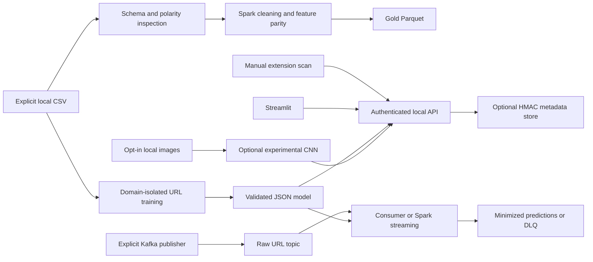

# Architecture and design decisions

## Data flow

The API and extension are not implicitly wired to Kafka. This is deliberate: a URL scan
must not secretly become an event in a retained raw-URL topic. Explicit publishers opt into
Kafka retention independently. Spark batch output contains URLs for offline training and
must be handled as sensitive dataset storage.

## Shared feature boundary

`features/url_features.py` is the one normalization and feature implementation. Spark's Python
UDF calls it; training calls it; JSON-model inference calls it. Feature order is declared in
`feature_schema.py` and its digest is checked when loading every model. Changing a feature
means retraining and regenerating the artifact, not accepting an old classifier silently.

Normalization accepts HTTP(S), removes fragments, converts hostnames to IDNA ASCII, rejects
credentials and obvious private literals/hostnames. It does not resolve hostnames because
classification never fetches pages. It is not a generic SSRF-safe fetcher. If a future feature
adds network access, it needs independent DNS pinning, egress restrictions and redirect checks.

## Model boundary

A standard scaler and five candidate classifier families are fitted on training rows. Registrable
PSL domains form leakage groups. A second domain-isolated validation split chooses the
threshold subject to a false-positive constraint; the untouched test split reports results.
The public suffix list is bundled by tldextract and network updates are disabled.

Export contains numeric arrays/validated trees, schema metadata and provenance digest. This avoids
pickle code execution and makes NumPy online inference independent of scikit-learn.
Portable predictions are compared against the fitted sklearn pipeline before export succeeds.
JSON artifacts still require a trusted supply chain; a hash beside a malicious artifact is
not an authenticity signature.

## Service boundary

Startup validates secrets and loads a model. Missing or invalid model stops startup. No
heuristic fallback masquerades as a trained classifier. Endpoints require an API key except
health. Body size is bounded even without Content-Length. Validation responses do not echo
inputs. Query strings are rejected. No CORS wildcard is enabled.

Rate limiting is global in-process and avoids retaining client IPs. It is intentionally
simple for local operation; multiple workers each get a separate budget. A reverse proxy
must provide connection timeouts, distributed rate limiting and TLS for any remote service.
The body limit controls memory, not slow-client connection duration.

## Persistence boundary

Raw URLs exist transiently in request memory and are not logged by the application. Optional
SQLite events contain UUID, timestamp, keyed URL digest, probability, verdict and model version.
The list endpoint omits the keyed digest. A retention task purges hourly; access and inserts
also purge. Disk deletion is logical, not secure erasure. Disable storage to avoid opening a
DB entirely. Dataset, Kafka, OS swap, backups and reverse-proxy logs have separate lifecycles.

## Delivery guarantees

The Python consumer processes an input, waits for acknowledged prediction or minimized DLQ
output, then synchronously commits the input offset. A crash between output acknowledgement
and offset commit replays the event. Downstream consumers must deduplicate by event ID.
Kafka idempotence reduces producer retries but does not make the whole pipeline exactly once.

Spark streaming persists offsets in its checkpoint and writes minimized Parquet rows. Corrupt
records produce an error and source offset, never a raw-payload DLQ. Checkpoints are unique per
query; model rollout uses a new query/checkpoint after offsets are explicitly planned.

## Optional vision boundary

The CNN consumes only explicit PNG/JPEG bytes. The extension has a separately consented visible-tab
capture path, disabled by default and unavailable until the local image model is enabled. It validates file size, pixels and decode,
uses a local weights-only load and never navigates to a page. Validation loss chooses the
checkpoint. Identical-byte leakage across train/val is rejected; site-level split quality is
still the dataset owner's responsibility. URL and image scores remain separate, because no
validated fusion calibration exists.
